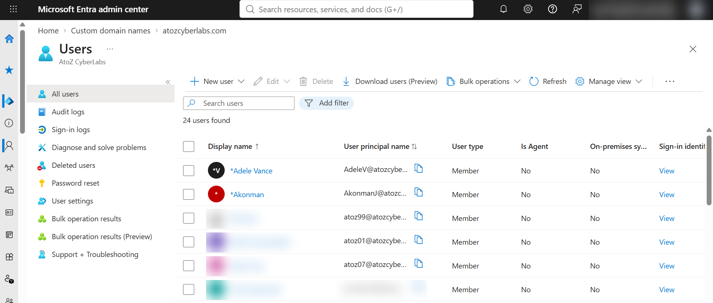
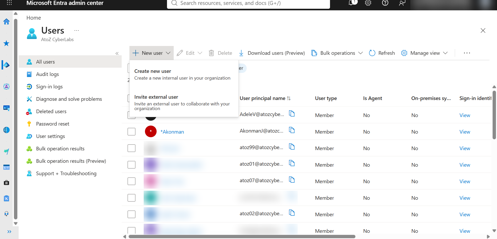
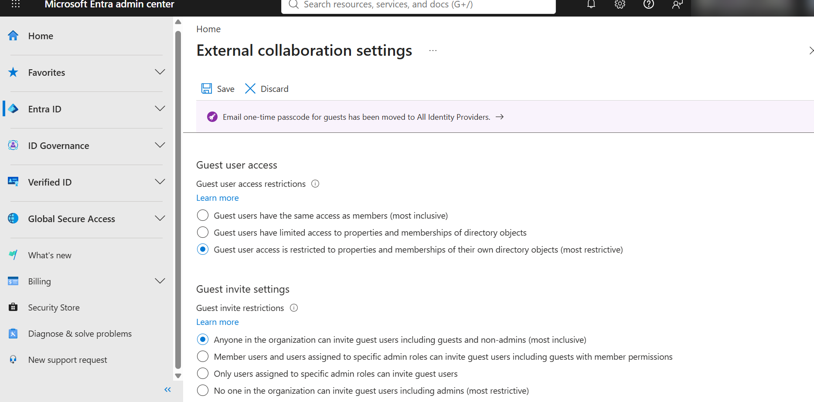
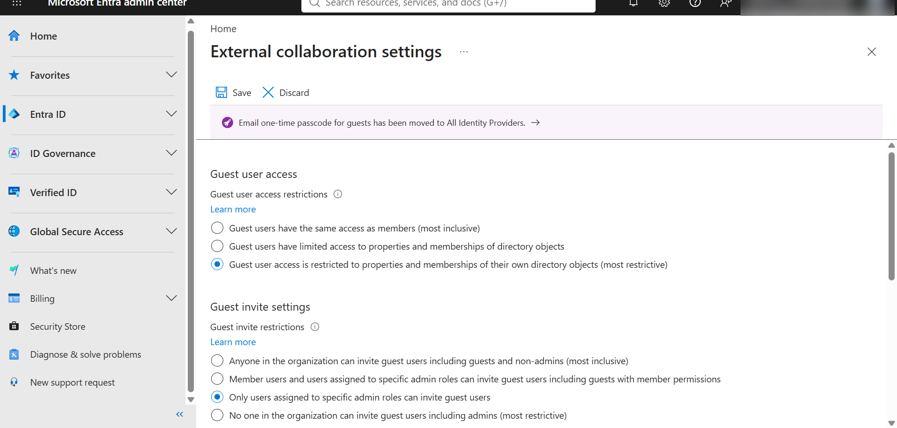

# 01: Explore identity in Microsoft Entra ID

**Module:** [Explore identity in Microsoft Entra ID](https://learn.microsoft.com/en-us/training/modules/explore-identity-azure-active-directory/)
**Done in:** my real tenant for AtoZ CyberLabs and Touchtel Wireless

## What this module covers

<!-- AJ: 2 to 3 sentences in your own words. What is identity, and what does Entra ID do? -->

## What I did

### 1. Created and managed Microsoft Entra users

Created a test user account named **Akonman** in the AtoZ CyberLabs Microsoft Entra tenant, alongside the existing staff accounts. This exercise showed user provisioning and centralized identity management, supporting NIST AC-2 (Account Management). Real names are blurred.

<!-- AJ: why did you mark test users with a * in front of the name? -->

### 2. Configured Microsoft Entra roles and least privilege

Assigned Akonman the **Authentication Administrator** and **License Administrator** roles instead of Global Administrator. That's enough to handle a lockout or a new hire's license without handing over the whole tenant. It's role-based access control (RBAC) and least privilege in practice, supporting NIST AC-6 (Least Privilege).

### 3. Changed the primary domain to the business domain

Changed the primary domain from the default onmicrosoft.com address to **atozcyberlabs.com**, so new accounts get the business domain. Every account now carries the same organizational identity, supporting NIST IA-4 (Identifier Management). Verifying the domain was an earlier lab: [M365 Lab 09: Entra custom domain](../../M365/09-microsoft-entra-custom-domain).

### 4. Reviewed tenant-wide properties and added a privacy contact

The lab asks you to change the tenant display name. This is my live business tenant, and that name shows on my staff's sign-in pages and emails, so I **kept the name as it is**. Knowing when not to click Save on a production system is part of the job (NIST CM-3, Configuration Change Control).

The one change I did make: the tenant had **no global privacy contact**, so I added one. Microsoft uses it to reach someone about privacy and data protection questions, and every business should have a named person for that (NIST PM-19, Privacy Program Leadership Role).

What the review confirmed:
- **Name:** AtoZ CyberLabs, matching the new brand
- **Data location:** United States datacenters
- **Technical contact:** set (blurred here)
- **Global privacy contact:** added in this lab (blurred here)
- **Gap found:** the **privacy statement URL is empty**. My website doesn't have a privacy page yet. Adding one, then linking it here, is on my to-do list (NIST PT-5, Privacy Notice).

### 5. External users: where guests come in

**Invite external user** is how outside people (a vendor, a contractor, an accountant) get a guest account in the tenant. Because that door exists, the next step was deciding who's allowed to open it and what guests can see. Real names, the admin account and the break-glass account are blurred.

### 6. Locked down guest access and guest invites
**Before** (invites open to anyone in the organization):

**After** (invites limited to specific admin roles):

| Setting | Before | After |
|---|---|---|
| Guest user access | Most restrictive | Most restrictive (kept) |
| Who can invite guests | Anyone in the organization, including guests and non-admins | Only users assigned to specific admin roles |

**Why I chose this:** I chose the most restrictive guest access setting so external users can only view information related to their own directory objects, which limits unnecessary exposure of tenant data. I also restricted guest invitations to users in specific administrative roles so external collaboration is controlled, reviewed, and aligned with least privilege and Zero Trust principles.

With invites open to anyone, any staff account, or a hacked one, could bring an outsider into the tenant. Now that takes an admin.

## NIST SP 800-53 mapping

| Control | Name | How this lab supports it |
|---|---|---|
| AC-2 | Account Management | New accounts are created in one place, with a type and a clear owner |
| AC-6 | Least Privilege | The user got two narrow roles instead of Global Administrator |
| IA-4 | Identifier Management | One naming scheme and one business domain for every account |
| CM-3 | Configuration Change Control | Reviewed tenant settings in production and only made the one change that was needed |
| PM-19 | Privacy Program Leadership Role | Added a named global privacy contact for the tenant |
| AC-3 | Access Enforcement | Guests can only see their own directory objects |
| AC-6 | Least Privilege (guests) | Only specific admin roles can invite external users |
| PT-5 | Privacy Notice | Found the missing privacy statement URL and logged it as a follow-up |

## Privacy

Real people's names and photos, the admin account name, the signed-in admin in the top corner, the tenant ID and contact emails are blurred.

## What I learned

<!-- AJ: 1 or 2 things that clicked for you in this module -->
