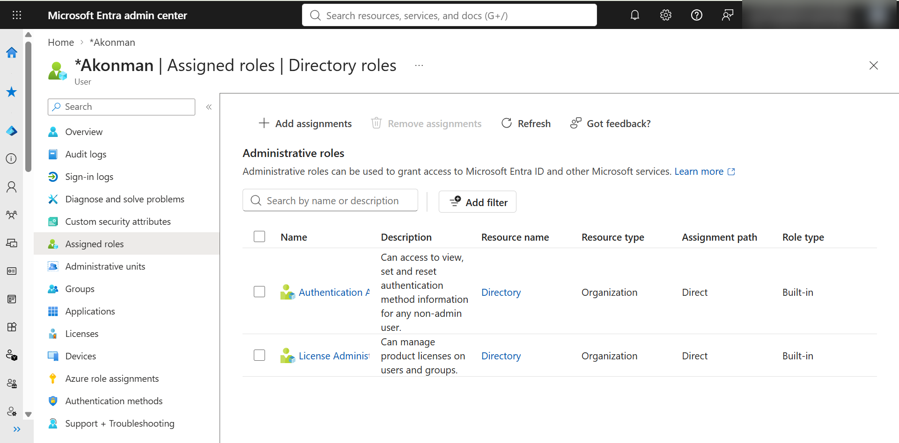

# 01: Explore identity in Microsoft Entra ID

**Module:** [Explore identity in Microsoft Entra ID](https://learn.microsoft.com/en-us/training/modules/explore-identity-azure-active-directory/)
**Done in:** my real tenant for AtoZ CyberLabs and Touchtel Wireless

## What this module covers

<!-- AJ: 2 to 3 sentences in your own words. What is identity, and what does Entra ID do? -->

## What I did

### 1. Created a user

Created **Akonman**, a test user, alongside the real staff accounts. Staff follow my naming scheme (**atozNN**), so every account traces back to one person. Real names are blurred.

<!-- AJ: why did you mark test users with a * in front of the name? -->

### 2. Gave the user only the roles they need

Instead of making the user a Global Administrator, I gave two narrow built-in roles:
- **Authentication Administrator:** can reset sign-in methods for regular (non-admin) users
- **License Administrator:** can manage product licenses on users and groups

That's enough to handle a "help, I'm locked out" call or a new hire's license, without the keys to the whole tenant.

### 3. Made my business domain the primary domain

Changed the primary domain from the default **atozcybercloud.onmicrosoft.com** to **atozcyberlabs.com**. New accounts now get @atozcyberlabs.com by default. Verifying the domain was an earlier lab: [M365 Lab 09: Entra custom domain](../../M365/09-microsoft-entra-custom-domain).

## NIST SP 800-53 mapping

| Control | Name | How this lab supports it |
|---|---|---|
| AC-2 | Account Management | New accounts are created in one place, with a type and a clear owner |
| AC-6 | Least Privilege | The user got two narrow roles instead of Global Administrator |
| IA-4 | Identifier Management | One naming scheme and one business domain for every account |

## Privacy

Real people's names and photos, the admin account name, and the signed-in admin in the top corner are blurred.

## What I learned

<!-- AJ: 1 or 2 things that clicked for you in this module -->
