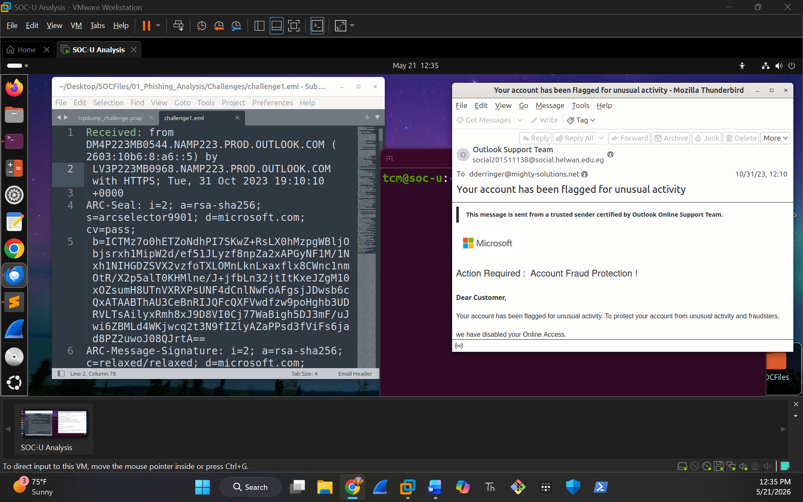

# Incident Report: Phishing Analysis Challenge 1

**Challenge file:** `01_Phishing_Analysis/Challenges/challenge1-phishin-emails.eml`  
**Verdict:** Malicious (credential phishing, Microsoft brand impersonation)  
**MITRE ATT&CK:** T1566.002 Phishing: Spearphishing Link  
**Tools:** header analysis, URL reputation lookup, sandbox, CyberChef (defanging IOCs)  
**GRC follow-up:** [Lab 002: Credential Phishing Investigation](../../GRC-Labs/Analysis-After-It-Happens/Lab-002-Phishing-Investigation.md)

---

## 📋 Artifact Discovery & Headers

| Field | Value |
|---|---|
| **Date** | Tue, 31 Oct 2023 10:10:04 -0900 |
| **Subject** | Your account has been flagged for unusual activity |
| **To** | dderringer@mighty-solutions.net |
| **From (display name)** | Outlook Support Team |
| **Sending address** | social201511138@social.helwan.edu.eg |
| **Reply-To** | social201511138@social.helwan.edu.eg |
| **Return-Path** | social201511138@social.helwan.edu.eg |
| **Sender IP** | 40.107.22.60 |
| **Resolved host** | mail-am6eur05on2060.outbound.protection.outlook.com |
| **Message-ID** | JMrByPl2c3HBo8SctKnJ5C5Gp64sPSSWk76p4sjQ@s6 |

---

## 🔍 Technical Artifact Analysis

### 1. Sender & Header Analysis

The display name says "Outlook Support Team," but the email comes from a university domain, not Microsoft. That's brand impersonation.

| Check | Result | What it tells me |
|---|---|---|
| **Display name vs sender** | Mismatch | Claims to be Microsoft, sent from `social.helwan.edu.eg` |
| **Sender domain** | Not Microsoft | A university domain with no link to the brand it's using |
| **SPF** | Pass | The sending IP is allowed to send for `social.helwan.edu.eg`. It doesn't prove the email is really from Microsoft. |
| **DKIM** | Pass | Signed by `socialhelwanedu.onmicrosoft.com`, a Microsoft 365 tenant. Microsoft infrastructure is not the Microsoft organization. |
| **DMARC** | bestguesspass | Weak alignment. Strict domain enforcement wasn't met. |

**Conclusion:** identity mismatch plus brand impersonation. Authentication passing only proves which domain sent the email, not that the Microsoft branding is legitimate.

### 2. URL Analysis

Two links in the email body (defanged with CyberChef):

- `hxxps[://]raw[.]githubusercontent[.]com/MalwareCube/SOC101/main/assets/01_Phishing_Analysis/microsoft[.]jpg`: the Microsoft logo used to make the email look real
- `hxxps[://]0[.]232[.]205[.]92[.]host[.]secureserver[.]net/lclbluewin08812/`: the credential harvesting page

**Reputation:** 6 of 91 vendors flagged the phishing link, with verdicts of phishing and malicious. No community comments yet. A detection rate that low means this infrastructure gets past most filters and gateways.

💡 **OPSEC note:** I check existing threat intel with the search tab instead of submitting a fresh URL scan. A new scan can tip off the attacker that someone is looking at their infrastructure.

### 3. Email File Analysis

| | |
|---|---|
| **File** | challenge1.eml |
| **MD5** | 8a0b2fec2b342e79880757b31800b0ed |
| **SHA256** | 91fc4aa2257b9c69684ac2bbc220ed7556c3db68cf725812ce365ef3febc8604 |

**Static:** the file is a standard email. Its body pulls in a remote image (the logo) and links to the phishing page. There's no malicious attachment. The threat is the link.

**Dynamic (sandbox):** opening the email made `OUTLOOK.EXE` connect to `raw.githubusercontent.com` and download `microsoft.jpg`. On its own, loading a remote image is normal email behavior. Here it's how the fake Microsoft logo gets displayed. The real danger is the credential page on `secureserver.net`, where a user who clicks would be asked for their password.

---

## 🚨 Case Verdict & Defensive Actions

**Final verdict:** Malicious

**Mitigation steps:**
- Blocked the phishing host and the exact image URL path at the perimeter firewall and web proxy. I blocked the specific path, not all of raw.githubusercontent.com, because developers and tools rely on that domain.
- Added the email file's SHA256 hash to the EDR blocklist.
- If the user clicked the link or entered a password: isolate the endpoint to prevent lateral movement, reset the password and review recent sign-ins. If they only received the email, removing it from mailboxes is enough.

---

## 📸 Challenge Screenshot

